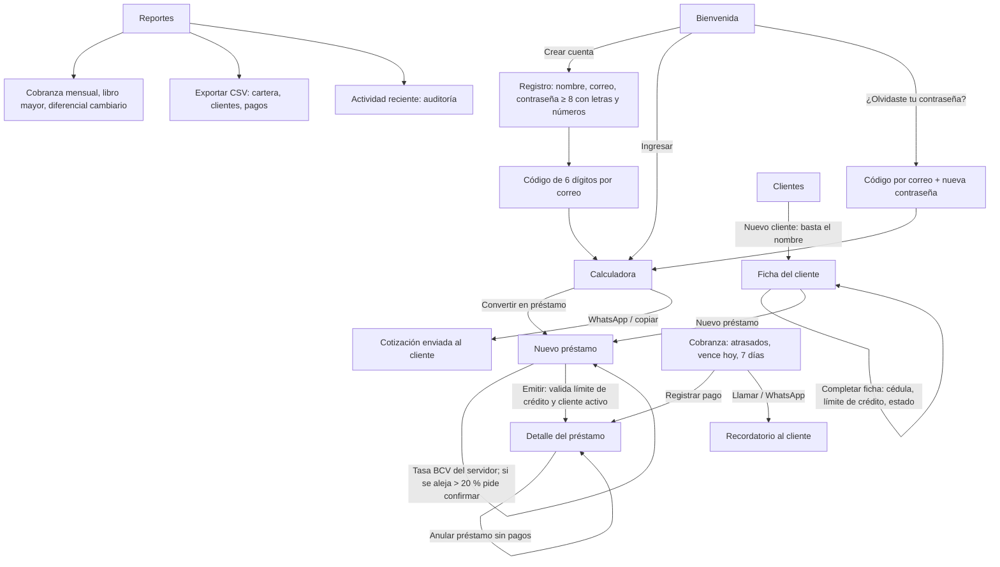

# Auditoría y prueba de punta a punta (14/10/2026)

Prueba hecha con una cuenta creada desde cero, en un Supabase local completo
(imagen oficial `supabase/postgres` 15.8 + GoTrue + PostgREST + buzón de correo),
instalado con `supabase/instalar/parte-1…8.sql` tal como se haría en el SQL Editor.
La app se compiló (`npm run build`) y se recorrió en Chromium con tamaño de teléfono (390 × 844).

## Diagrama de flujo de la app

## Resultado del recorrido

| # | Paso | Resultado |
| --- | --- | --- |
| 1 | Registro con contraseña débil (`abc123`) | Rechazada: «al menos 8 caracteres» |
| 2 | Registro válido → código por correo → dentro de la app | OK |
| 3 | Calculadora $1.000 al 8 % semanal sin fecha de fin | Interés $80/semana, primer cobro a 7 días |
| 4 | Convertir en préstamo → cliente rápido «Pedro Pérez» → emitir | Préstamo #1; tasa BCV precargada desde el servidor |
| 5 | Cliente «Ana Gómez» con límite $500 → préstamo de $600 | Rechazado: «supera el límite… disponible 500,00 USD» |
| 6 | Tasa escrita 21,55 (BCV 215,5) | Pide confirmar; «Usar tasa BCV» la corrige |
| 7 | Préstamo fijo $400 del 01/07 al 29/09, mora 1 % y 3 días de gracia | 3 cuotas vencidas; mora $204,80 calculada correctamente |
| 8 | «Exigible hoy» en Bs en préstamo en USD | Rechazado (capital solo en USD); ahora el botón propone solo intereses y mora |
| 9 | Pago Bs 52.754,40 (= $244,80) | Mora $188,67 + interés $56,13; capital intacto |
| 10 | Pago con fecha anterior al último | Aviso de fecha retroactiva y rechazo por orden cronológico |
| 11 | Pago $100 + «Cancelación total» $340 | Préstamo **pagado** |
| 12 | Anular el último pago | Vuelve a **activo** con el saldo exacto |
| 13 | «Anular este y los posteriores» | Todo revertido, incluida la mora devengada |
| 14 | Préstamo abierto: interés en Bs y abono de $500 | Capital pendiente $500 |
| 15 | Cobranza y recordatorio por WhatsApp | Montos y mensaje correctos |
| 16 | Reportes y CSV de cartera, clientes y pagos | OK |
| 17 | Bloquear cliente / eliminar cliente con préstamos | No se le puede prestar / no se puede borrar |
| 18 | Anular préstamo sin pagos | Anulado; ahora muestra saldo 0 |
| 19 | Cambiar contraseña sin la actual / con la actual equivocada / correcta | Rechazado / rechazado / OK |
| 20 | Cerrar sesión, entrar con la clave vieja y con la nueva | Rechazada / OK |
| 21 | Recuperar contraseña con código | OK |
| 22 | Abusos directos contra la API | Ver abajo: todos bloqueados |

Abusos probados contra la API (como desde la consola del navegador): un anónimo no lee tablas ni ejecuta
funciones internas; otra cuenta no ve, no paga ni anula nada ajeno; el dueño no puede insertar préstamos
directo, cambiar montos de pagos, borrar la auditoría, insertar tasas BCV, registrar pagos con fecha futura
ni una tasa absurda sin confirmar.

## Incongruencias encontradas durante la prueba (corregidas)

1. **Confirmación de registro pedía «Nueva contraseña»**: la pantalla del código reutilizaba la de recuperación.
2. **El foco saltaba al correo** 100 ms después de abrir el modal: si alguien escribía rápido (o con un gestor de contraseñas), el texto terminaba en el campo equivocado.
3. **«Exigible hoy» en Bs para un préstamo en USD** proponía un monto que incluía capital y que el servidor rechaza.
4. **Préstamo anulado seguía mostrando saldo pendiente** ($54) en el detalle y en las listas.
5. **Fecha de la tasa BCV en UTC**: a las 8 p. m. de Caracas mostraba el día siguiente.
6. Montos propuestos con punto decimal (`147574.40`) en lugar de coma; textos «Calculadora» en el acceso; «los 1 pago(s)».
7. `/api/bcv` decía `verifiedAgainstBCV: false` al devolver una tasa oficial guardada.

## Decisiones de negocio que conviene conocer

- **Interés cobrado por adelantado no se devuelve.** Si en un préstamo sobre saldo se cobra el interés de un período que aún no vence y luego, en ese mismo período, el cliente abona a capital, ese abono reduce los intereses desde el período siguiente; el interés ya cobrado no se reintegra. Si se abona primero el capital, el interés del período baja. La app ahora lo avisa en el formulario de pago.
- **Un cliente con préstamos (aunque estén anulados) no se puede eliminar**, para conservar el historial; se puede marcar como inactivo.
- **Pagos con fecha anterior a hoy** se permiten (registrar un cobro del día que ocurrió), siempre en orden cronológico; la mora se calcula a esa fecha. La app lo advierte y la auditoría guarda cuándo se registró.
- La recuperación de contraseña envía un código de acceso de un solo uso (en Supabase la plantilla se llama «Magic Link»); conviene personalizar su texto en *Authentication → Email Templates*.

## Lo que no se pudo probar aquí

- Las fuentes de tasa externas (BCV, DolarApi, open.er-api) están bloqueadas en este entorno: se usó una tasa BCV guardada.
- El modo sin conexión del service worker (Playwright bloquea los service workers); la configuración se verificó en la compilación.
- Inicio de sesión con Google/Apple (requiere credenciales OAuth reales).

## Prueba de fallos (18/10/2026): «no deja registrar usuarios ni préstamos y no se ve la tasa BCV»

Se reprodujo la situación real: la app publicada (rama `main`, sin las correcciones) con una base de datos
que tiene aplicadas las partes 1 a 7 y no la 8 (que falló con «Failed to fetch»).

| Falla | Causa | Arreglo |
| --- | --- | --- |
| Al confirmar el registro, la app pide «Nueva contraseña»; si se repite la misma, Supabase responde `same_password` y vuelve a mostrar «Crear cuenta», como si el registro hubiera fallado | Código de `main`: la pantalla del código de registro reutilizaba la de recuperación | Ya corregido en la rama: la confirmación solo pide el código |
| No se pueden registrar pagos: «La base de datos no está actualizada» (`fin_devengar_mora(uuid, date) does not exist`) | La parte 7 borraba una función que el registro de pagos viejo usa hasta que la parte 8 lo reemplaza | Nuevas partes 8, 9 y 10; la función vieja ahora se borra en la parte 8, después de reemplazar el registro de pagos |
| No se puede emitir un préstamo con una tasa que se aleja más del 20 % de la BCV guardada | La base ya valida la tasa (parte 7), pero la app de `main` no tiene la casilla «Confirmo que es correcta» | Publicar la app de la rama, que muestra la casilla |
| No se ve la tasa BCV en el teléfono ni en la calculadora | Desde el commit `7a85a9a` la calculadora no tiene campo de tasa y el chip del encabezado está oculto en pantallas pequeñas (`hidden sm:inline-flex`) | Chip BCV visible en todos los tamaños y bloque «Tasa de cambio» en la calculadora, con «Actualizar», equivalencias en Bs y la tasa pasada al préstamo |

Con la app de la rama y las partes 1 a 10: registro → código → dentro de la app; tasa BCV visible en el
teléfono y en la calculadora; cliente, préstamo y pago correctos; con una tasa de 300 (BCV 215,5) la app pide
confirmarla y, confirmada, emite el préstamo y registra el pago.
